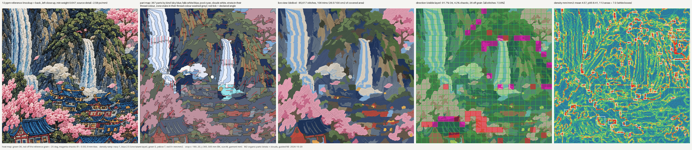

# Benchmark - Castle Falls BK size M crop (ENGINE_PLAN M0)

Every engine milestone is scored on the same crop with the same gates (`engine/digitize/bench.py`). Rows are appended;
a re-run of the same label at the same engine commit replaces its own row (M2). Config: `bench.json` (crop, targets), registration: `registration.json` (config as data).

**Crop.** ENGINE_PLAN asked for x -180...+20, y 370...570 mm. Its bottom 5 mm fell outside the back_left close-up's
registered region (feather weight down to 0.25 against the 0.6 threshold), so the crop is **x -180...+20, y 365...565 mm**
(shifted 5 mm up; min weight 0.647). Garment mm on the BK piece: x from CB (+ = wearer's right), y from the CB neck seam.

**Reference quality.** The reference is sampled on a 12 ppm GRID; that is not a detail guarantee. The real source
detail is ~2.6 px/mm in this crop (register.reference `source_ppm`: the back_left close-up), and direction_match masks
8 mm tiles whose close-up weight is < 0.6 (`masked` in the rows; 0 here, the crop lies inside the close-up).

**Gates** (qa.py): direction_match on the visible layer at 12 ppm (>= 85 % OK, <= 5 % chaotic), angle_coherence per
part (needs part ids; a DST has none), density_map (areas over 7 mm/mm2), trims_per_area (<= 25 / 100 cm2 of covered
area), satin_shape (0 blobs, nothing > 7 mm), stack_map (<= 2 layers), colours (<= 12 threads, red and gold present).
"Dir all" = the old score over every stitch including underlay, for comparison only.

## Baseline (19 Oct 2026): the shipped Rev B DST fails every gate, as intended

DST `projects/castle-falls-jacket/out/01_back-scene/M/HAKI_CSFL_01_back-scene_BK_M.dst` (sha256 b8dd2fcf852983f3,
build output not in the repo, read from the main checkout), origin (-0.009, 330.3) mm from `result_BK.json`.
Product status unchanged.

| gate | baseline | target | |
|---|---|---|---|
| direction_match, visible layer, 12 ppm, 625 tiles of 8 mm | 11.7 % OK, 77.9 % chaotic, 65 off-grain | >= 85 % OK, <= 5 % chaotic | FAIL |
| (old score: every stitch incl. underlay) | 2.4 % OK, 97.3 % chaotic | info only | |
| angle_coherence | 535 constructed regions (WALL / ROOF / TMB) in the crop, 0 with a part id, 479 with an "auto" angle -> raises | per part, declared | FAIL |
| density_map (all stitches, 1 mm grid) | mean 5.67, p95 10.45 mm/mm2; 194 areas (66.2 cm2) over 7.0 | 0 areas | FAIL |
| trims_per_area (DST read-back) | 452 trims on 399.8 cm2 of covered area = 113.1 per 100 cm2 of covered area | <= 25 per 100 cm2 covered | FAIL |
| satin_shape | 1925 satin columns: 1159 blobs (aspect < 2.5), 31 under 1 mm, 0 over 7 mm; 319 radial fans | 0 blobs | FAIL |
| stack_map | up to 6 layers; 19.97 cm2 (5.1 % of covered cells) over 2 | <= 2 | FAIL |
| colours | 12 threads (24 stops in the crop); no red, no gold (merged into rose / cream at build) | <= 12, red + gold | FAIL |

Reading it: the direction failure is mostly chaos (fragments sewn at their own angles, the A16 symptom), not wrong
grain. Judging only the visible layer raised the score from 2.4 % to 11.7 %, so underlay was hiding part of the picture,
but most of the failure is real. The angle_coherence FAIL is plumbing, not a measurement: the Rev B scene carries no
part ids, so the gate raises before it measures anything (M1 runs carry part ids from the plan into the DST labels). Fans are counted, not failed: rule 4 allows radials on florets, and telling a floret
from a window fan needs the part map (M1+). stack_map counts sewn runs; objects joined by hidden travel share a run, so
it can only under-count.

## M1 skeleton (20 Oct 2026): parts, declared angles, falls as cords

`PYTHONPATH=engine python3 -m digitize.run projects/castle-falls-jacket/bench/run_bk_crop.yaml --stages all --no-api`
(zones: `zones_BK.json`, hand-authored windows + tone families; run config: `run_bk_crop.yaml`). The DST is a build
output in `out/digitize/BK_M_crop/` (not in the repo).

| check | baseline | M1 | target | |
|---|---|---|---|---|
| direction, visible layer (625 tiles, 0 masked) | 11.7 % OK, 77.9 % chaotic | 89.0 % OK, 7.0 % chaotic | >= 85 %, <= 5 % | OK / FAIL |
| ... fall_cord tiles | - | 98.4 % (61 tiles) | >= 85 % | OK |
| ... sky_band tiles | - | 100 % (2 tiles: the crop has almost no sky) | >= 85 % | OK, thin evidence |
| ... zone_stub tiles / pool tiles | - | 88.0 % (552) / 75.0 % (8) | (stubs: M2/M3) | info |
| parts | none (535 unlabelled constructed regions) | 381: 14 fall cords, 2 sky bands, 4 pools, 361 stubs; 18.4 % under 20 mm2 | <= 400, < 25 % | OK |
| angles | 479 "auto", random fills | 0 undeclared, 0 random: 20 by rule, 361 field-mean | 0 | OK |
| angle_coherence (by plan part id) | raises (no ids) | 109 fails, all stubs/pool: 58 buried (< 12 visible stitches), 51 spread > 10 deg | 0 | FAIL |
| satin shape | 1159 blobs, 319 fans | 0 satins, 0 blobs, 0 fans | 0 blobs | OK |
| density | 194 areas > 7 | 78 areas (13.8 cm2), mean 4.43 | 0 | FAIL |
| stack | max 6, 19.97 cm2 > 2 | max 5, 8.7 cm2 > 2 (where 3+ zones meet) | <= 2 | FAIL |
| trims per 100 cm2 of covered area | 113.1 (452) | 33.0 (132) | <= 25 | FAIL |
| colours | 12, no red, no gold | 12, red (24 parts) and gold (13 parts) sewn | <= 12, red + gold | OK |
| stitches in crop / stops | 150,250 / 24 | 84,090 / 17 (file 91,317 incl. travel) | | info |

Reading it: falls and sky follow the reference grain; every part has a declared angle; red and gold survive. What
fails is the zone STUBS (one field-mean angle per tone component): chaos and off-grain tiles sit in the village roofs and
mixed foliage, and small buried stub parts trip angle_coherence. Those are M2/M3 (direction fields, strata, crowns,
buildings). Thread v0 merged the two water blues away (area-weighted), so the falls are cream + mist only (M4).

## M2 organic parts (20 Oct 2026): strata + clouds along the reference grain

Same command, run config `run_bk_crop.yaml` (now with `direction`, `stratum`, `cloud`, `specks` and thread `importance`),
zones `zones_BK.json` (new: `cliffs` = stratum splitter, `cloud_centre` = cloud splitter, `foliage` stub claimed before the
cliffs). Scored at engine commit 4dae159 (row `git_sha`). Gates now read the WRITTEN DST (`compile.labelled_dst`: 85,269
planned segments matched in sew order, 520 writer ties, 60 sub-grid). Every number below is from `out/digitize/BK_M_crop/gates.json`.

| check | M1 | M2 | target | |
|---|---|---|---|---|
| direction, visible layer (625 tiles, 0 masked) | 89.0 % OK, 7.0 % chaotic | 90.1 % OK, 6.2 % chaotic (23 off-grain, 39 chaotic) | >= 85 %, <= 5 % | OK / FAIL |
| ... ORGANIC tiles, SAME 164 tiles (top part = stratum / cloud in M2), M1 DST vs M2 DST | 90.9 % OK, 8.5 % chaotic | 92.7 % OK, 6.7 % chaotic | (improve on M1) | better, still > 5 % chaos |
| ... stratum_band tiles (151) | 90.7 % / 8.6 % (M1 stubs there) | 92.7 % / 6.6 % | | |
| ... cloud tiles (6 lobe + 3 shade) | 83.3 % of 6 | 83.3 % of 6, 100 % of 3 | | too few tiles to judge |
| ... zone_stub tiles (385, left for M3) | 86.8 % / 7.3 % | 87.5 % / 6.8 % | | info |
| ... by direction SOURCE: independent (rule) / self-derived (field, field-mean) / outline | 95.8 % of 71 / 88.0 % of 552 / - | 97.3 % of 73 / 89.0 % of 545 / 100 % of 4 | | see note |
| parts | 381; 18.4 % under 20 mm2 | 367 (84 stratum bands, 19 cracks, 3 lobes, 2 shades, 1 wisp, 14 cords, 3 pools, 2 sky, 239 stubs); 11.2 % under 20 mm2; 326 traced specks merged | <= 400, < 25 % | OK |
| angles | 0 undeclared, random_angles hard-coded 0 | 0 undeclared; random_angles DERIVED = 0 (audit re-derives all 367); 0 sewn off their declared angle | 0 | OK |
| angle_coherence (fixed-angle fills) + field adherence (guided parts) | 109 fails | 53 fails (12 buried + 39 spread, all stubs; 1 pool, 1 wisp); guided parts: 94.4 % of 8,049 visible stitches within 15 deg of their planned field | 0 | FAIL |
| satin shape + split-satin cords (new DST cord gate) | 0 / 0 (cords not checked) | 0 satins, 0 blobs; 14 cords: 0 flags, max piece 7.01 mm, aligned splits <= 0.18 | 0 blobs | OK |
| density | 78 areas (13.8 cm2), mean 4.43 | 112 areas (16.4 cm2), mean 4.56, p95 8.44 | 0 | FAIL |
| stack | max 5, 8.7 cm2 > 2 | max 5, 11.5 cm2 > 2 | <= 2 | FAIL |
| trims per 100 cm2 of covered area | 33.0 (132) | 27.5 (110) | <= 25 | FAIL (closer) |
| colours | 12; red + gold; NO water blue | 12; red (22 parts) + gold (13 parts); sky light kept (falls cords cream / sky light) | <= 12, red + gold | OK |
| stub area left for M3 | (all but falls / sky / pool) | 27,180 mm2 = 60.4 % of part area: village 11,389, blossom 6,470, foliage 6,306, ground 3,015 | | info |
| stitches in crop / file / stops | 84,090 / 91,317 / 17 | 85,386 / 92,866 / 22 | | info |

Reading it:
- **Organic tiles improved, modestly.** On the same 164 tiles the M2 DST scores 92.7 % OK / 6.7 % chaotic against M1's
  90.9 % / 8.5 %. Chaos that remains sits where a stratum band meets a stub (foliage crowns at one field-mean angle) or
  where the reference grain itself is weak (reference coherence 0.06-0.39 in the chaotic stratum tiles): two textures
  meeting inside one 8 mm tile. Crowns (M3) and sequencing / cut-under at junctions (M4) are the next levers.
- **Gate circularity (M1 review).** Strata, cloud lobes and stubs take their direction FROM the reference grain the gate
  grades them against, so 545 of 625 tiles are SELF-DERIVED: an OK there says "the file follows the plan's field", not
  "a digitizer would choose this". The field is smoothed at 4 mm (the gate measures at ~2.7 mm), which keeps them from
  being identical, but it is still the same pixels. Only the 73 independent tiles (rule angles: falls, sky, pools) are
  evidence in the strict sense (97.3 %). The founder's live-view look (M4) is the independent check for organic parts.
- **Threads.** `importance {cf_skylt: 3, cf_rose: 3}` keeps one water blue and blossom deep; mist grey merges into sky
  light (dE 14.9), so rock highlights and the cloud shade read light blue. Keeping both blues costs blossom deep or
  cloud cream (RECAP-2026-10-20-engine-m2-organic.md); founder's call.
- **Density / stack got slightly worse** (more zones meeting: foliage over cliffs over ground, each with its 1 mm
  underlap and edge run): guided-fill interiors are 3.07 mm/mm2 like tatami (3.15); the flags are at part edges (M4).
- **Trims fell** to 27.5 / 100 cm2 (specks merged into their neighbours, fewer tiny islands).
- Looked at the live view: falls cream / sky-light cords; cliffs read as navy / slate / tan strips along the grain; the
  cloud is one cream mass with horizontal rows and a sky-light open shade; village, blossoms and crowns are still flat
  stubs.

## Scoreboard

| date | label | dir OK % (visible) | chaotic % | dir all % | angle coh. | density mean / p95 / flags | trims per 100 cm2 of covered area | satins / blobs / >7 mm / <1 mm / fans | max stack / cm2 > 2 | threads (red, gold) | gates passed |
|---|---|---|---|---|---|---|---|---|---|---|---|
| 2026-10-19 | baseline: shipped Rev B DST | 11.7 | 77.9 | 2.4 | FAIL: no part ids | 5.67 / 10.45 / 194 | 113.1 (452) | 1925 / 1159 / 0 / 31 / 319 | 6 / 19.97 | 12 (n, n) | 0/8 |
| 2026-10-20 | M1 skeleton (sky + falls splitters, zone stubs) | 89.0 | 7.0 | 63.5 | FAIL (109) | 4.43 / 8.09 / 78 | 33.0 (132) | 0 / 0 / 0 / 0 / 0 | 5 / 8.7 | 12 (y, y) | 3/8 |
