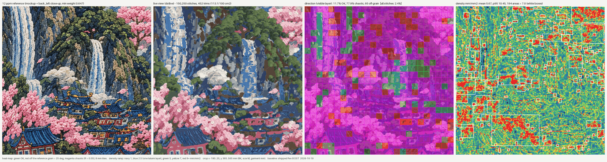

# Benchmark - Castle Falls BK size M crop (ENGINE_PLAN M0)

Every engine milestone is scored on the same crop with the same gates (`engine/digitize/bench.py`). Rows are appended,
never edited. Config: `bench.json` (crop, targets), registration: `registration.json` (config as data).

**Crop.** ENGINE_PLAN asked for x -180...+20, y 370...570 mm. Its bottom 5 mm fell outside the back_left close-up's
registered region (feather weight down to 0.25 against the 0.6 threshold), so the crop is **x -180...+20, y 365...565 mm**
(shifted 5 mm up; min weight 0.647). Garment mm on the BK piece: x from CB (+ = wearer's right), y from the CB neck seam.

**Gates** (qa.py): direction_match on the visible layer at 12 ppm (>= 85 % OK, <= 5 % chaotic), angle_coherence per
part (needs part ids; a DST has none), density_map (areas over 7 mm/mm2), trims_per_area (<= 25 / 100 cm2 of covered
area), satin_shape (0 blobs, nothing > 7 mm), stack_map (<= 2 layers), colours (<= 12 threads, red and gold present).
"Dir all" = the old score over every stitch including underlay, for comparison only.

## Baseline (19 Oct 2026): the shipped Rev B DST fails every gate, as intended

DST `projects/castle-falls-jacket/out/01_back-scene/M/HAKI_CSFL_01_back-scene_BK_M.dst` (sha256 b8dd2fcf852983f3,
build output not in the repo, read from the main checkout), origin (-0.009, 330.3) mm from `result_BK.json`.
Product status unchanged.

| gate | baseline | target | |
|---|---|---|---|
| direction_match, visible layer, 12 ppm, 625 tiles of 8 mm | 11.7 % OK, 77.9 % chaotic, 65 off-grain | >= 85 % OK, <= 5 % chaotic | FAIL |
| (old score: every stitch incl. underlay) | 2.4 % OK, 97.3 % chaotic | info only | |
| angle_coherence | 535 constructed regions (WALL / ROOF / TMB) in the crop, 0 with a part id, 479 with an "auto" angle -> raises | per part, declared | FAIL |
| density_map (all stitches, 1 mm grid) | mean 5.67, p95 10.45 mm/mm2; 194 areas (66.2 cm2) over 7.0 | 0 areas | FAIL |
| trims_per_area (DST read-back) | 452 trims on 399.8 cm2 = 113.1 / 100 cm2 | <= 25 | FAIL |
| satin_shape | 1925 satin columns: 1159 blobs (aspect < 2.5), 31 under 1 mm, 0 over 7 mm; 319 radial fans | 0 blobs | FAIL |
| stack_map | up to 6 layers; 19.97 cm2 (5.1 % of covered cells) over 2 | <= 2 | FAIL |
| colours | 12 threads (24 stops in the crop); no red, no gold (merged into rose / cream at build) | <= 12, red + gold | FAIL |

Reading it: the direction failure is mostly chaos (fragments sewn at their own angles, the A16 symptom), not wrong
grain. Judging only the visible layer raised the score from 2.4 % to 11.7 %, so underlay was hiding part of the picture,
but most of the failure is real. Fans are counted, not failed: rule 4 allows radials on florets, and telling a floret
from a window fan needs the part map (M1+). stack_map counts sewn runs; objects joined by hidden travel share a run, so
it can only under-count.

## Scoreboard

| date | label | dir OK % (visible) | chaotic % | dir all % | angle coh. | density mean / p95 / flags | trims / 100 cm2 | satins / blobs / >7 mm / <1 mm / fans | max stack / cm2 > 2 | threads (red, gold) | gates passed |
|---|---|---|---|---|---|---|---|---|---|---|---|
| 2026-10-19 | baseline: shipped Rev B DST | 11.7 | 77.9 | 2.4 | FAIL: no part ids | 5.67 / 10.45 / 194 | 113.1 (452) | 1925 / 1159 / 0 / 31 / 319 | 6 / 19.97 | 12 (n, n) | 0/8 |
