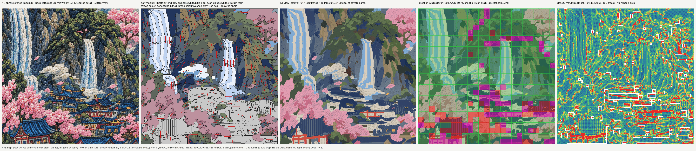

# Bench write-up: M3a buildings (20 Oct 2026)

Row "M3a buildings (rule-angled roofs, walls, members; depth by tier)" in BENCH.md / SCOREBOARD.json, scored at engine
commit 49aebb8 (branch `engine-m3a-buildings`, origin/main 182a82b with M6 merged in at fdc02d8; 49aebb8 only adds M4g
sequencing hints to part meta, the DST is identical). Command:
`PYTHONPATH=engine python3 -m digitize.run projects/castle-falls-jacket/bench/run_bk_crop.yaml --stages all --no-api`.
Every number below is from `out/digitize/BK_M_crop/gates.json` (DST sha256 acf15572ac4d0e32), or from a scratch
variant run named as such (never benched).

## What changed on the crop

The `village` zone (one whole-area window, `stub` splitter) became five building windows (temple, pagoda, castle
centre, houses right, roof line at the bottom) with the `building` splitter. Inside each window the template fitter
traces the roof / wall / member / ornament tones (run yaml `building.roles`) and fits:

| part | rule (house.yaml M3a block) | count on the crop |
|---|---|---|
| roof plane | NEAR tier: down the slope (perpendicular to the fitted eave; hips fan to their hip line, 20-45 deg off the front). FAR tier (fitted height < `near_tier_mm` 22): along the eave (rule 3, far = near-horizontal), one plane | 13 (1 near: the temple) |
| wall plane | one angle per plane, square to the eave of the roof above: along it under a far roof, across it under a near roof | 21 |
| eave | satin across, along the fitted eave line (near tiers only; a far tier's eave is its own edge row) | 1 |
| roof tile lines | bean down the slope in the plane's second roof tone (near tiers only) | 2 |
| window band | a row of windows as ONE satin band across it (aspect >= 3 incl. the sewn width) | 3 (28 windows too small for a band, 17 bands dropped at an underlap) |
| member | timber / trim satin across its width | 1 (7 dropped at an underlap) |
| stud | dot 1-1.5 mm, never touching | 6 |

Pixels of other tones inside a building window go back to the zones below: foliage stubs grew 6,306 -> 7,902 mm2 and
ground stubs 3,015 -> 4,079 mm2 (M3b replaces those). Village stub area: 11,389 mm2 -> 0.

## Crop table (M2 row vs M3a)

| check | M2 (71f0097) | M3a (49aebb8) | target | |
|---|---|---|---|---|
| direction, INDEPENDENT tiles (gate) | 98.6 % of 73 = 11.7 % coverage | **79.9 % of 204 = 32.6 % coverage** | >= 85 % on >= 50 % | FAIL (both) |
| ... building tiles (top part roof / wall / window / stud / tile line) | 0 (village was self-derived stubs) | 134: roof 49 / 74 OK, wall 42 / 56 OK | | |
| (combined, info) | 91.7 | 86.7 | | info |
| chaos, all tiles (DST only) | 4.2 % | 4.3 % | <= 5 % | OK |
| parts / under 20 mm2 | 367 / 11.2 % | 324 / 10.8 % | <= 400, < 25 % | OK |
| random angles (audited) / sewn off angle | 0 / 0 | 0 / 0 (67 rule angles re-derived from stored fit points) | 0 | OK |
| angle_coherence fails | 61 | 42: stubs 26, wall 6, roof 2, window 1, cloud wisp 1, **stud no-visible-stitches 6** | 0 | FAIL |
| separation close (rule 3) | 46 of 118 | 24 of 110 (no building-internal pair; village vs ground stub 2) | 0 | FAIL |
| density flags / mean / p95 | 113 / 4.57 / 8.41 | 163 / 4.75 / 8.97 (roof 49 and wall 50 flags touch building parts; 143 of 163 where >= 2 zones meet) | 0 | FAIL |
| max stack / cm2 > 2 | 4 / 9.07 | 5 / 12.08 | <= 2 | FAIL |
| trims per 100 cm2 | 26.5 (106) | **23.3 (93)** | <= 25 | **OK (new)** |
| satin / blobs / cords | 0 / 0 / 14 cords 0 flags | 10 satins, 0 blobs, 0 too narrow / wide, 1 fan (reported, not gated: earlier runs read it on a tile line's serpentine step), 14 cords 0 flags | 0 blobs | OK |
| colours | 12, red + gold | 12, red + gold | | OK |
| stitches file / stops | 93,036 / 22 | 93,961 / 28 | | info |
| gates | 3/9 | **4/9**: chaos, trims, satin, colours | | |

## The independent-coverage gate (the brief's main question)

Rule-angled building tiles moved the independent count from 73 to **204 of 625 tiles (+131)**. The coverage gate
needs >= 50 % (313 tiles): buildings alone cannot reach it on this crop; the rest is cliffs (160 tiles, field-derived)
and foliage / blossom / ground stubs (245 tiles) whose directions are read from the reference. Independent OK fell from
98.6 % to 79.9 % because the new 131 tiles are harder than falls and sky:
- temple roof (the one near tier): 11 off-grain tiles. Its tile rows FAN in perspective (left ~110, right ~55 deg in
  the reference); the fitter could not see either side edge (crop edge on the left, a blossom crown on the right), so
  the roof is one front plane at 90 deg.
- roof line at the bottom: 6 tiles; its eave is below the crop.
- walls: 11 off-grain tiles, mostly under tiers where the AI render stitched short diagonal strokes.

## Decision: depth by tier (rule 3), measured

The playbook says roofs down the slope; rule 3 says far parts near-horizontal, near parts near-vertical. The reference
renders every small castle tier as rows ALONG its eave and the big near temple roof down the slope, and the gate's 8 mm
tiles cannot hold a horizontal wall and a vertical roof 5 mm apart without reading chaos. Both rules are applied: a tier
is FAR when its fitted height (75th percentile of bottom - top over the unoccluded columns) is under `near_tier_mm`.

| variant (scratch runs, not benched) | independent OK of 204 | chaos all | trims / 100 cm2 | gates |
|---|---|---|---|---|
| playbook only (`near_tier_mm: null`: every tier down the slope) | 44.1 % (70 chaotic) | 16.0 % | 27.8 | 2/9 |
| `near_tier_mm: 15` | 75.0 % | 5.4 % | 23.8 | 3/9 |
| **`near_tier_mm: 22` (house.yaml)** | **79.9 %** | **4.3 %** | **23.3** | **4/9** |

22 mm was chosen on THIS crop (the temple tier is 26 mm; the castle tiers 5-14 mm, one merged pair 20 mm), so it is a
founder-tunable number, not a fitted one. **Founder question:** do far tiers read right as rows along the eave
(live view), and is 22 mm the line between far and near?

## Honest gaps

- **Windows:** 3 bands survive of ~45 traced windows. 28 are single windows too short for a satin band (rule 9: windows
  as bands, smaller dropped); 17 bands sat on a 1 mm underlap (a wall's border with a lower zone) and were clipped /
  dropped so they would not be a third layer (rule 6). With no underlap clearance only 3 more survive and the stack is
  unchanged, so clearance is kept (`seam_keep_mm` 1.0). The live view loses the window rows the reference shows.
- **Walls read tan / brown**, not cream: the evidence classifies most plaster pixels as bark tan; the wall takes the
  LIGHTEST thread with >= 25 % of the plane.
- **Studs** (1-1.5 mm dots) show < 12 visible stitches, so angle_coherence flags each `no-visible-stitches` (6). The flag
  is kept (LESSONS A22); whether a bead belongs in a fill-direction gate is a gate-scope question for M4.
- **Stack 5 / density 163:** building planes underlap each other and the foliage / cliffs around them (1 mm each side).
  Junction sequencing is M4.
- Hips were fitted on the pagoda top and a castle tier, then merged away (far tiers are one plane). No near roof on this
  crop has a visible hip edge.

## Default-preserving (scripts/identity_check.sh on the branch, after merging main)

dst2 probe dst 84ff50ea74938675 / pes 1ecd8f657db3f53a; M5 wb svgrun DST 449c14f6e8f693b6 (15,069 stitches, 161 trims);
Castle crop DST **changes** to acf15572ac4d0e32 (intended: the village zone uses the new splitter). The same branch with
main's `zones_BK.json` (village = stub) reproduces main's crop DST 0d86f00be8e9f8fa, so the additive hooks change
nothing on their own.
