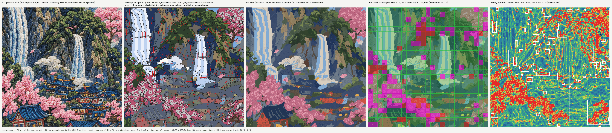

# BENCH M3b: trees, crowns and florets on the Castle BK crop (20 Oct 2026)

Command: `PYTHONPATH=engine python3 -m digitize.run projects/castle-falls-jacket/bench/run_bk_crop.yaml --stages all --no-api`
(label "M3b trees, crowns, florets"). Every number below is read from `out/digitize/BK_M_crop/gates.json` / `plan.json`
of the bench run at the commit in the SCOREBOARD row; crop DST sha256 `62b6a2306a19cb49` (M2: `0d86f00be8e9f8fa`, the
change is intended: this milestone replaces the blossom / foliage stubs and adds trunk parts).

## What changed on the crop

| zone (zones_BK.json) | M2 | M3b |
|---|---|---|
| blossom (z 7) | 59 zone stubs, tatami at the field mean | `blossom` splitter: 12 canopies (deep tone, knocked out), 216 radial 5-petal florets, 299 bead knots (83 alone in the canopy where the floret would be under 1.5 mm radius) |
| foliage (z 2) | 97 zone stubs | `crown` splitter: 63 clumps (seeded by the lit highlights), 59 lit pieces |
| trunks (new, z 6.5, bark tones, whole-crop window) | in the ground stub | `trunk` splitter: 96 bark components, 17 held by blossom (>= 35 % blossom pixels in a 2 mm ring), 49 limbs -> 46 branch columns + 7 trunk strips; 79 bark components without a crown around them (rock tan, timber) go back to the zones below |

## Crop table: M2 row vs M3b

| | M2 (71f0097) | M3b | target |
|---|---|---|---|
| direction, INDEPENDENT tiles (gate) | 98.6 % of 73 (11.7 % coverage) | 71.2 % of 125 (20.0 % coverage) | >= 85 % on >= 50 % |
| (combined, info) | 91.7 % | 80.6 % | |
| chaos, all 625 tiles | 4.2 % | **14.2 % (FAIL; was OK)** | <= 5 % |
| ... without the 38 floret tiles (info) | 4.2 % | 11.2 % | |
| parts / under 20 mm2 | 367 / 11.2 % | 981 / 49.1 % (florets and beads are small by design) | <= 400, < 25 % |
| random angles (recomputed) | 0 | 0 (679 splitter-built angles rebuilt from meta construct) | 0 |
| angle_coherence fails | 61 | 104 (crown dark 21 + lit 30, zone stubs 43, canopy 6, trunk 2) | 0 |
| field adherence / radial adherence / column adherence | 94.4 % / - / - | 93.8 % / 99.3 % (184 florets, 1,740 visible stitches) / 84.9 % (46 branches, 564 stitches: under 85, so coherence fails on it too) | >= 85 % |
| separation (rule 3) close pairs | 46 of 118 | 43 of 239 | 0 |
| ... of which in M3b zones (blossom, foliage, trunks, ground) | blossom 1, foliage 3, foliage/village 1, ground 2, ground/village 1 = 8 | blossom 1 (a bead on the canopy edge), foliage 4, ground 3 = 8 | |
| satin shape + cords | 0 / 0 | 0 / 0 (223 floret runs + 1 bead underlay run re-filed by the part map, see below) | 0 blobs |
| density flags / mean / p95 | 113 / 4.57 / 8.41 | 107 / 5.52 / 11.03 | 0 |
| max stack / cm2 over 2 | 4 / 9.07 | 5 / 21.28 | <= 2 |
| trims per 100 cm2 covered (trims) | 26.5 (106) | 34.0 (136) | <= 25 |
| colours | 12, red + gold | 12, red + gold | |
| stub area (% of part area) | 27,180 mm2 = 60.4 % (village 11,389, blossom 6,470, foliage 6,306, ground 3,015) | 13,792 mm2 = 27.4 % (village 10,901, ground 2,890; blossom 0, foliage 0) | (M3 total: 0) |
| stitches file / stops | 93,036 / 22 | 127,760 / 29 | |
| gates | 3/9 | **2/9: satin + cords, colours (lost: chaos)** | 9/9 |

## Floret count (A2 / A14)
Splitter: 299 floret centres (lightness peaks >= 1.5 mm apart in the blossom silhouette, 4 ppm evidence) -> 216 petalled
florets + 83 bead-only. Independent count on the 12 ppm reference (Laplacian-of-Gaussian blobs, radius 1.5-3.5 mm, inside
the same silhouette; a different detector, grid and scale; scratchpad m3b/count.py): **339 blobs** (344 / 332 at LoG
threshold 0.03 / 0.05). 163 of the 339 blobs (**48 %**) have a petalled floret centred within 2 mm and 216 (64 %) a bead; in numbers, 216
petalled florets = 64 % of the blob count, 299 beads = 88 %. The splitter UNDER-counts: neighbouring domes that touch without a lightness
dip merge into one peak. The stitched florets are smaller than the reference domes (whole florets that fit their Voronoi
cell, radius 1.5-3.2 mm), so the deep canopy shows more than in the reference.

## Direction evidence: what is independent (A24)
| source | tiles | OK | chaos | bucket |
|---|---|---|---|---|
| trunk strips (axis of the traced stroke) | 2 | 0 | 2 | independent (caveat: on a thin trunk the outline and the grain share the same edges) |
| branch columns (across the traced centreline) | 6 | 0 | 5 | independent |
| florets (radial from the detected centre) | 38 | 13 | 23 | independent |
| knots (bead rows between petal axes) | 5 | 4 | 0 | independent |
| crown clumps (fan along the clump's long axis) | 95 | 58 | 23 | **outline**, not independent: the rule was CHOSEN after comparing it with the reference grain (below) |
| canopy (field mean) | 62 | 38 | 19 | self-derived |

Choices made by looking at the reference grain, so the gate cannot count them as evidence:
- Canopy: a rule angle of 45 deg matched 0 % of the canopy area (scratchpad m3b/diag_crown.py); the field mean was
  kept (self-derived, like the M2 stubs). "Random tatami" (random penetrations) is NOT implemented: plain tatami.
- Clumps: "fan from the attachment to the clump centre" matched 38 % of the clump area, "along the clump's long axis,
  from the attachment end" 61 % (57.9 % on the final parts). The second was kept and is bucketed as outline.

## Why chaos and density went up
- **Radial florets read as chaos by construction.** A floret is ~5 mm across; an 8 mm tile over 1-2 florets holds rays
  in every direction (R < 0.55). 23 of the 89 chaotic tiles are floret tiles. The playbook says "radial florets" and the
  chaos gate says <= 5 %: they cannot both hold on a blossom canopy at 8 mm tiles. Question for the coordinator /
  founder: exempt radial parts from the chaos tile count (they are judged by radial adherence, 99.3 %), or florets at
  one angle per floret.
- Crown clumps: 63 clumps at their own fan angles inside 8 mm tiles (23 chaos tiles) where the stubs had one field-mean
  angle per tone blob.
- Density / stack: florets and beads grow 1 mm under the canopy (underlap) and radial satin converges near the centre;
  stack 5 where branch, canopy, floret and knot meet. M4 (sequencing / cut-under) territory.

## Trims
Florets sewn ON the canopy cost 54 trims in their stop and lit clump pieces on the dark 34 (run r8). M3b sews details
FIRST and knocks them out of the fill (LESSONS B2 / B14, the M4g `knockout_of` contract): 196 -> 118 trims. Making the
beads visible (a deep bead inside a pink floret instead of a pink bead the 12-thread plan made invisible) costs 18 more:
136. Branches sew before the canopy (not last as the playbook lists them): they sit in gaps, so only the 1 mm seam
changes, and it saves ~1 trim per branch island.

## Satin-shape gate and the part map
qa.satin_shape cannot tell a floret from a fan in a window (its docstring); with the 1.5 mm knot hole and dst2's
shortened alternate rays, 223 floret runs (193 blob, 30 too narrow) read back as satin "blobs" / "too narrow". `run.florets_by_part_map` re-files
a flagged run whose stitches are mostly labelled with a RADIAL part (and a < 1.5 mm run inside a bead: the dot plugin's
cross underlay) and records the counts (`satin.floret_runs_by_part_map`, `bead_runs_by_part_map`). A flag on any other
part stays. The bench `satins` column (884) still counts floret runs as satins.

## Not done / next
- Florets: 216 petalled florets = 64 % of the reference count, 48 % matched one-to-one; size 1.5-3.2 mm radius (reference ~2.6 mm domes tiling the canopy). Overlapping
  florets (back ones partly hidden) instead of Voronoi-fit ones.
- Pale blossom thread: the 12-thread plan merges blossom pale into blossom pink (`importance` trade-off, M2 RECAP);
  the florets have no pale highlight.
- Trees: only cherry trunks / branches are detected (the pines on the cliffs show no trunk); 54 of 63 clumps attach to
  "bark" pixels (cf_brown, often shadow), 9 to the mass base. "Every clump touches a branch" is literal only where the
  reference shows bark.
- Branch columns: constant width (column satin), the traced branch tapers.
