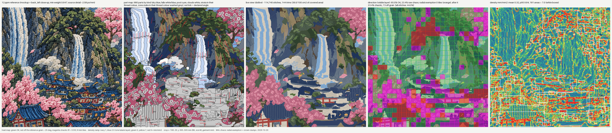

# BENCH M4c: radial-floret chaos exemption + crown clumps (20 Oct 2026)

Castle BK crop, label "M4c chaos: radial exemption + crown clumps", scored at engine b5bdb3d365a7 (later commits change
docstrings / notes only). Baseline = origin/main 89a16e8 run in the same session (crop DST 1963d24fc2d3d862, as on main).

## Crop table (numbers from gates.json of each run)

| | main (M3b row) | M4c |
|---|---|---|
| direction, independent OK | 49.5 % of 194 | 51.0 % of 194 |
| chaos raw / after radial exemption / exempt tiles | 24.8 % (155) / n.a. | 23.4 % (146) / 23.4 % / 0 |
| crown tiles: chaos / off-grain / OK (dark + lit) | 25 / 16 / 68 of 109 | 15 / 28 / 67 of 110 |
| angle_coherence fails | 110 | 78 |
| crown: lit with < 12 visible stitches | 27 | 0 |
| crown: dark clumps angle-spread / lit angle-spread | 30 / 3 | 24 / 7 |
| separation close pairs (crown pairs) | 23 (4) | 25 (6) |
| random angles | 0 | 0 |
| parts / stub area | 992 / 6.9 % | 980 / ~6.9 % |
| trims per 100 cm2 | 36.8 (147) | 36.0 (144) |
| density flags | 167 | 181 |
| max stack | 5 | 5 |
| satin blobs | 0 | 1 (see below) |
| stitches in file | 125,086 | 124,076 |
| gates | 2/9 (satin, colours) | 1/9 (colours) |

## 1. Radial-floret exemption: built exactly to the review's conditions, exempts 0 tiles

`engine/digitize/gates_radial.py`. A chaotic tile leaves the chaos count only if >= 70 % of its visible stitch length
belongs to floret-size radial parts (farthest outline point <= 4 mm from meta.centre) and >= 85 % of those parts'
visible stitches in the tile lie within 15 deg of their ray. Numbers in house.yaml `chaos_radial_exemption`; the 5 %
threshold is untouched. gates.json `radial_exemption` lists raw, after, exempt, and every refused candidate tile with
its radial share and adherence.

On the crop no tile qualifies. Of 64 chaotic tiles with any radial thread, the radial share is 0.01 to 0.56 (median
~0.25). Adherence is not the problem (mostly 92-100 %). Over the 52 chaotic tiles topped by blossom parts, the
visible thread is canopy ~50 %, florets ~23 %, travel ~15 % (unlabelled running stitches on top), branches 4 %. Inside
those tiles the canopy alone is fairly coherent (R 0.6-1.0); everything but the florets together has R 0.26-0.83.
The review's estimate (23 exempt tiles) counted tiles whose TOP part is a floret; by visible thread the florets are a
minority in every tile. Conclusion: florets are one cause of the blossom chaos, not the main one. The remaining
causes are the canopy broken around the florets, and travel lines over the canopy (visible in the live view as long
diagonal lines across the blossom). The travel is M4s's travel-on-fill gate.

Exempted tiles would go to a "radial" bucket (a partition: they leave their source bucket, never counted as OK). Doing
this raises the source bucket's pct_ok because failing tiles leave its denominator; `direction_by_source_raw` keeps
the unmoved figures so the effect stays visible. On this crop nothing moves (0 exempt).

## 2. Crown clumps

`extract/splitters/crown.py` (+ rule `fan_smooth` in construct.py):
- Lit pieces too small for a judgeable tatami (< 20 mm2 or < 2.5 mm wide) are grown inside their clump (0.25 mm
  steps, at most 1.5 mm). None are dropped. 46 pieces grown, +458 mm2. Pieces that touch after growing become one
  (77 -> 73). Lit area 4,097 -> 4,579 mm2 (+12 %), dark 5,949 -> 5,283. The reference reads lit-heavy (many small
  lit tops per clump), so this moves toward the mockup, but highlights are up to 1.5 mm larger than traced.
- Dark slivers < 0.5 mm between a lit piece and the clump edge join the lit piece (65 mm2).
- One angle per clump: lit and dark share it.
- Smooth fan: the clump angle is the axial mean of its own long-axis fan and its touching clumps' fans at half
  weight. Measured on main's plan before building, touching pairs > 45 deg apart: own axis 34 of 80, smoothed 9, a
  fan from the mass base 4, the reference grain itself 7. Clump area within 25 deg of the reference grain: own axis
  62 %, smoothed 59 %, base fan 9 %. A clump that rule 3 cannot then separate from its neighbours keeps its own axis
  (4 clumps). Without this fallback the crown close pairs went 4 -> 10 (run r1).
- The audit rebuilds `fan_smooth` from the stored axes. Dark: own axis `to` within 2 mm of the clump (the dark part
  plus its own lit pieces), `from` within 6 mm (touches its support). Lit: holds its `at` point. Neighbours: within
  25 mm. Bucket: outline (A24).

Result: unseen lit 27 -> 0. Crown chaos tiles 25 -> 15. Crown off-grain tiles 16 -> 28. The smoothing mostly
converts chaos into deviation from the reference grain: crown OK tiles 68 -> 67. Dark spread 30 -> 24 clumps (the
remaining spread is edge stitches and travel inside fragmented clumps).

## What failed / is left
- Satin gate: 1 blob at (-56.4, 369.3) in a 34 mm2 dark clump on the crop's top edge. The DST there zig-zags: a
  tatami block ends and the next block of the same part starts 3.8 mm back, joined by a stitch, not a trim. That
  reads as a 3.5 mm satin. A row/block-join issue in shared code (dst2 / compile) that shows up at this clump's new
  angle (175.6 vs 169.1 deg). Not fixed here.
- Density flags 167 -> 181: grown lit pieces underlap 1 mm into the dark. SEAM_MM (sequence.py) could give
  crown_clump_lit the 0.3 mm seam the florets use. Not done: shared file.
- Chaos is still 23.4 %: canopy, florets and travel in the blossom (49 tiles), village walls/roofs (39), crowns (15).
- Visual: crowns now show more lit tops, closer to the reference. They still read as flat patches next to the
  reference's many small layered pads. Blossoms are unchanged from main (rose canopy, pale florets, travel lines visible).
