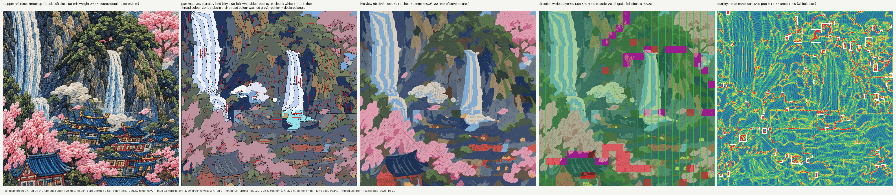

# Bench: M4g (thread planner, full sequencing, review step), Castle BK M crop, 20 Oct 2026

Run with the M2 parts (M3a / M3b not merged; numbers move again when they are). Command:
`PYTHONPATH=engine python3 -m digitize.run projects/castle-falls-jacket/bench/run_bk_crop.yaml --stages all --no-api`.
Every number below is from `gates.json` / `plan.json` of that run (DST sha256 239edce864f8fdd3, after the PR #8 review
fixes; the first PR's DST was f4a6545a46672615). Reproduce M2 with `sequence: {planner: m1}` (DST 0d86f00be8e9f8fa).

| check | M2 | M4g first PR (8ebced8) | **M4g after review (seam band kept)** | target | |
|---|---|---|---|---|---|
| direction, INDEPENDENT tiles (gate) | 98.6 % of 73 | 98.6 % of 73 | 98.6 % of 73 (11.7 % coverage) | >= 85 % on >= 50 % | FAIL (not evidenced; M3) |
| (combined, info) | 91.7 | 91.4 | 91.5 | | |
| chaos | 4.2 | 4.6 | 4.3 | <= 5 % | OK |
| parts / under 20 mm2 | 367 / 11.2 % | 367 / 11.4 % | 367 / 11.2 % | | OK |
| coherence fails (fixed fills) / field adherence | 61 / 94.4 % | 50 / 94.2 % | 54 (13 buried + 41 spread) / 94.1 % | 0 | FAIL (stubs: M3) |
| separation close pairs | 46 | 42 | 45 | 0 | FAIL (stubs: M3) |
| **visible seams without underlap** (rule 6, >= 0.5 mm; own lower part / any lower part) | 4.5 % / 3.2 % | **33.5 % / 28.1 %** | **13.1 % / 5.0 %** | | info (new) |
| density flags / mean / p95 | 113 / 4.57 / 8.41 | 40 / 4.33 / 7.63 | **84** / 4.46 / 8.14 | 0 | FAIL (fewer than M2) |
| max stack / area over 2 | 4 / 9.07 cm2 | 4 / 1.0 cm2 | **4 / 4.41 cm2** (15 flagged regions); plan geometry max 2 | <= 2 | FAIL |
| trims per 100 cm2 | 26.5 (106) | 22.2 (89) | **20.0 (80)** | <= 25 | **OK** |
| colour stops (12 threads) | 22 | 20 | 20 (0 z-DAG violations) | | |
| stitches (file) | 93,036 | 90,922 | 92,822 | | |
| gates | 3/9 | 4/9 | **4/9** (+ trims) | | |

## The seam trade (PR #8 review must-fix 2): the stack gain was paid for in underlap, so the band is back
Seam metric (`sequence.seam_report`, plan geometry): for every pair of touching fill parts of different z, the seam is
the higher part's outline where the LOWER part's visible area meets it, minus stretches buried under a third higher
part; a seam point HAS underlap when the lower fill runs >= 0.5 mm under the higher part there. "own" = the pair's own
lower part; "any" = any lower fill under the edge. Equal-z neighbours (traced partitions, neither sews first, so no
underlap by design) are reported apart: ~78 m on this crop, every version. (The reviewer's whole-pair measure, all
touching pairs incl. equal z: M2 33 %, first PR 49 %.)

| stack reach cut | visible seams w/o underlap (own / any) | stack area > 2 | density flags | trims /100 cm2 |
|---|---|---|---|---|
| M2 (no stack cut) | 4.5 % / 3.2 % | 9.07 | 113 | 26.5 |
| exact 3-deep cut only (no reach) | 13.2 % / 5.0 % | 7.21 (*) | 74 (*) | 21.2 (*) |
| reach 1 mm, band 0 (first PR) | 33.5 % / 28.1 % | 1.0 | 40 | 22.2 |
| reach 1 mm, band 0.5 mm | 21.7 % / 14.7 % | 2.47 | 55 | 20.8 |
| **reach 1 mm, band 1.0 mm = house cut_keep_mm (default)** | **13.1 % / 5.0 %** | **4.41** | **84** | **20.0** |
(*) measured before the inner travel and look-ahead, the rest of the pipeline then differed.

Reading it: with the house band, the reach cut costs NO seam beyond the exact 3-deep cut (13.1 vs 13.2 %; "any lower"
5.0 = 5.0 %): the extra underlap loss of the first PR is gone, and so is most of its stack and density gain
(1.0 -> 4.41 cm2, 40 -> 84 flags). The remaining 13 % (own) is the necessary cut where three fills were really stacked:
there a different lower part (the middle one) still backs the seam in all but 5 %. M2's 4.5 % is lower because M2
kept the third layer. `sequence.stack_keep_band_mm` sets the band (default = keep_mm 1.0; 0.5 is the coordinator's floor).

**Stack gate after the fix (strict, unchanged, failing).** 441 cells over 2: 351 are junction cells (3 parts meet in one
1 mm cell, no point 3 deep), 78 have a run whose hidden travel crosses, 12 are 3 deep (mostly pull-comp at triple
points). Plan geometry: max 2 everywhere.

## What moved it, measured (ablations on the same parts, first PR, band 0; scratchpad m4g/)
| step | trims /100 cm2 | density flags | stack max / cm2 > 2 | coherence fails |
|---|---|---|---|---|
| M2 | 26.5 | 113 | 4 / 9.07 | 61 |
| order_v1 + stack cut (no orientation) | 20.8 | 127 | 6 / 10.48 | 53 |
| + orientation, blocks re-ordered nearest-next (first try) | 19.5 | 49 | 4 / 5.89 | 113 (travel on sewn rows) |
| + orientation keeping the technique's cell walk (chains) | 21.2 | 74 | 4 / 7.21 | 52 |
| + stack reach 1 mm (band 0) | 21.2 | 29 | 4 / 3.53 | 50 |
| + inner travel (underlay paths, narrow-neck fallback) | 20.2 | 33 | 4 / 0.96 | 53 |
| + stop lookahead (22 -> 20 stops) = first PR | 22.2 | 40 | 4 / 1.0 | 50 |
Tried and dropped: trimming hidden travel over 30 / 15 mm (dst2 opt-in): trims 36.5 / 50.2, stack unchanged (4 / 3.5).
Planning travel between TOP cells through the unsewn area: trims unchanged, coherence 50 -> 56, plan stage 150 s.

**Density.** The planned blocks alone (top + underlay) give 7 flags; the M2 file gave 113: the excess was the router's
TRAVEL between a part's own blocks (31 of 44 m of straight-line moves). Planned entry / exit cuts the moves 53 -> 33 m.
With the seam band back, the overlap bands under seams of two higher parts (1 mm cells with 3 runs) return as density.

**Stops vs trims.** The stop look-ahead saves 2 colour changes (22 -> 20) and cost 8 trims / 7 density flags on the
first PR's crop (`sequence.stop_lookahead: false` gives 22 stops).

## Thread trade-off (a QUESTION, not decided): `threads.choice` in run.yaml, or answer `threads.tradeoff`
| option | what it costs instead (merges vs the default) | worst dE | |
|---|---|---|---|
| default (importance {skylt 3, rose 3}) | mist grey -> sky light (14.9) | 16.5 | |
| keep_cf_mist (mist AND sky light) | cloud cream -> mist grey (15.0): the cloud whites go grey | 16.5 | |
| keep_cf_pinklt | cloud cream -> blossom pale (19.7) | 19.7 | NOT RECOMMENDED (> 18) |
| keep_cf_sky (sky blue AND slate) | sky light -> sky blue (18.7), mist grey -> cloud cream (15.0) | 18.7 | NOT RECOMMENDED |
| keep_cf_grnlt | cloud cream -> moss light (20.2) | 20.2 | NOT RECOMMENDED |
| saliency (contrast x motifs) | leaf green -> pine dark (18.6) | 18.6 | NOT RECOMMENDED |
Optical mixes the question lists (not sewn; a mix is a second layer): mist grey as 50 % cream + 50 % slate dE 5.2 (vs 14.9
merged); sky blue as 50 % sky light + 50 % navy dE 6.1; blossom pale as 50 % cream + 50 % pink dE 6.7.

## Review round trip on the crop (scratchpad m4g/answers_crop.json, first PR)
Answers `threads.tradeoff: keep_cf_mist`, `direction:low_grain:village: 0 deg`, `zone_stub:ground: accept stub`, plus an
unknown `q001`: the next run reported 3 answered, 10 left at their default (listed), 1 unknown; its threads hold cf_mist
and not cf_cream; the 6 low-grain village parts sew at 0 deg with source "answer"; random angles 0. Since the review:
answers about parts / zones the next run no longer has are reported as `stale` in answers_report.json.
